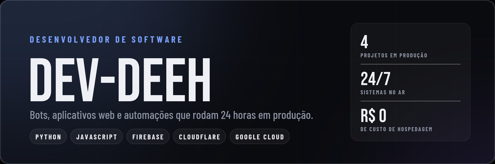
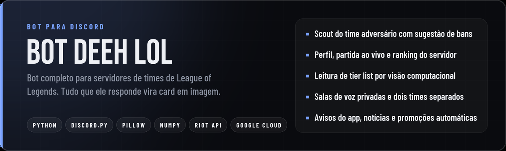
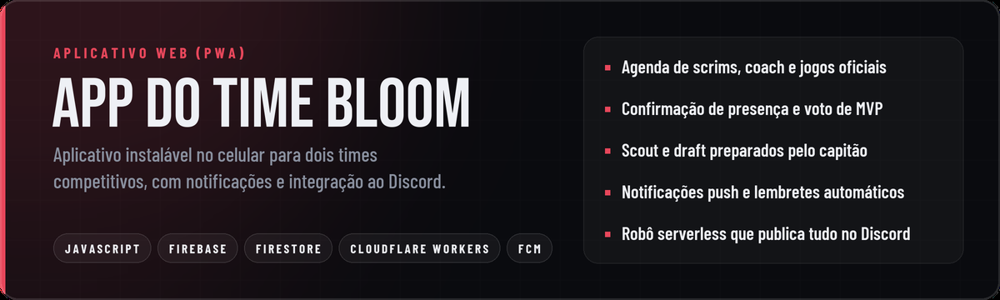
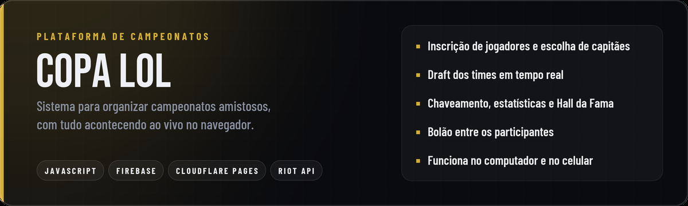
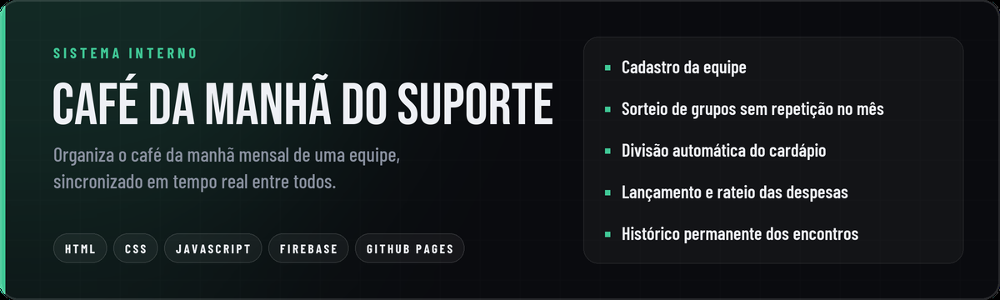

## Sobre

Desenvolvedor de software focado em produtos que as pessoas usam todos os dias: bots para Discord,
aplicativos web instaláveis no celular e automações que rodam sozinhas na nuvem.

Cuido do projeto de ponta a ponta: entendo o problema com quem vai usar, desenho a interface, escrevo o
código, coloco no ar e acompanho em produção. Gosto de soluções simples, rápidas e com custo de hospedagem
zero, usando Python, JavaScript, Firebase, Cloudflare e Google Cloud.

## Projetos

**Bot Deeh LOL**: bot de Discord para times de League of Legends, no ar 24 horas e usado por dois times.
Analisa adversários pela API da Riot e sugere bans, reconhece tier lists por imagem, organiza o servidor e
transforma os avisos do aplicativo do time em cards.
[Ver o código](https://github.com/Dev-Deeh/bot-lol-discord)

 

**App do time Bloom**: aplicativo web instalável (PWA) usado pelos times Bloom White e Bloom Red. Agenda,
confirmação de presença, voto de MVP, scout e draft, com notificações push e um robô serverless no
Cloudflare que publica tudo no Discord. Código privado.

 

**Copa LoL**: plataforma para campeonatos amistosos com inscrições, escolha de capitães, draft ao vivo,
chaveamento, estatísticas e bolão, tudo em tempo real no navegador.
[Abrir o site](https://copa-lol.pages.dev/)

 

**Café da Manhã do Suporte**: sistema interno que organiza o café da manhã mensal de uma equipe, do sorteio
dos grupos ao rateio das despesas, sincronizado entre todos.
[Abrir o site](https://dev-deeh.github.io/cafe-da-manha-suporte/) ·
[Ver o código](https://github.com/Dev-Deeh/cafe-da-manha-suporte)

## Tecnologias

| Área | Ferramentas |
|---|---|
| Linguagens | Python, JavaScript, HTML, CSS, SQL |
| Back-end e bots | discord.py, aiohttp, SQLite, APIs REST |
| Front-end | JavaScript puro, PWA, Service Worker |
| Dados e nuvem | Firebase (Firestore, Hosting, Cloud Messaging), Cloudflare Workers e Pages, Google Cloud |
| Imagem | Pillow e NumPy para gerar cards e reconhecer imagens |

 

League of Legends é marca registrada da Riot Games, Inc. Estes projetos não são endossados pela Riot Games.

