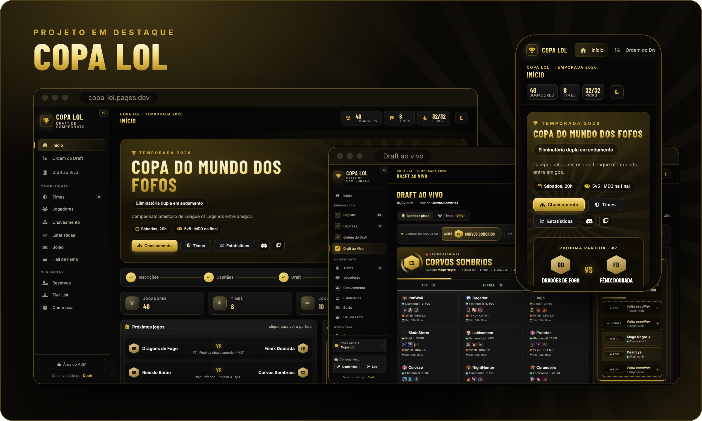
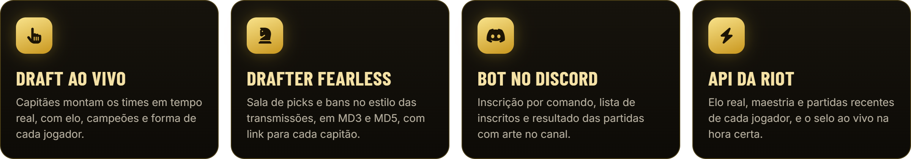

 

## 🏆 Copa LoL

Plataforma completa para campeonatos amistosos de League of Legends: inscrições, capitães, draft dos times ao vivo, chaveamento, estatísticas, bolão e Hall da Fama. Os jogadores acompanham tudo em tempo real, no computador ou no celular.

  
  
  
  
  

 

## 🤖 Bot de LoL para Discord

  
  
  
  

 

Copa LoL e Bot de LoL não são endossados pela Riot Games. League of Legends é marca registrada da Riot Games, Inc.

